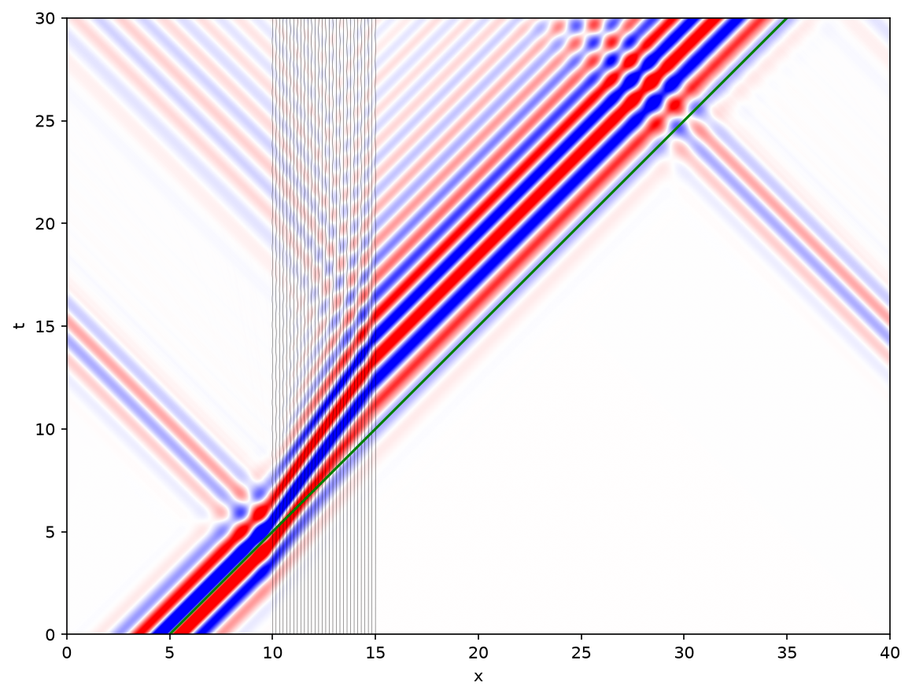

# electro_1d

Light in matter, in one dimension. A plane wave crosses a slab made of sheets of charges held by springs. Each
sheet radiates at the speed of light *c*; the slab's index, and its apparent slowness, come out of the sum.



## Contents

- `notebook.ipynb` integrates Maxwell's equations on a staggered (Yee) grid with point charges on springs, using
  JAX and diffrax.
- `coupled_sheets/` solves the linear problem exactly, without a grid, frequency by frequency. It handles
  normal incidence (`normal.py`) and an s-polarized oblique beam (`oblique.py`). It also provides the slab,
  pulse and beam of the study (`medium.py`) and the reference indices (`dispersion.py`).
- `figures/` holds one script per figure or animation of the notes.
- `validation/` runs the notebook's grid solver, before and after the Yee fix, against the exact solution
  (figure H).
- `notes/notes.typ` gives the derivations and formulas, in French, with the candidate figures of the article.
- `tests/` checks the exact solvers against transfer matrices of the stack.

Everything is written under `out/`, which git ignores.

## Running

Run every command from the repository root, with [uv](https://docs.astral.sh/uv/). Add `--extra cuda` to use
an NVIDIA GPU.

```sh
uv run --group dev pytest tests                     # exact solvers vs transfer matrices
uv run python figures/spacetime.py                  # first: front.py and animation_pulse.py read its data
uv run python figures/<name>.py                     # any other figure, into out/figures/
uv run python validation/compare.py && uv run python figures/validation.py
typst compile --root . notes/notes.typ out/notes.pdf
uv run --with jupyter jupyter lab notebook.ipynb
```
